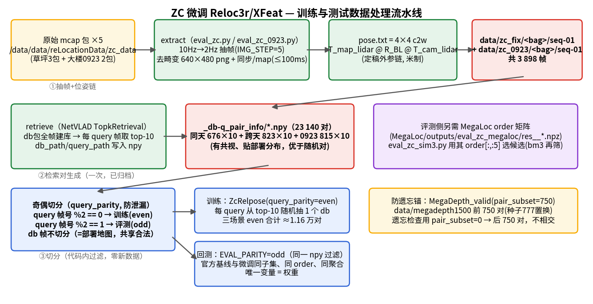
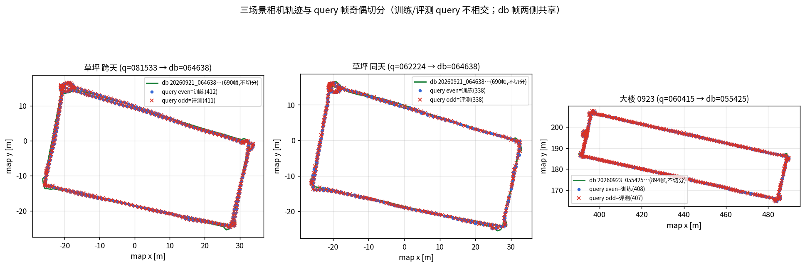
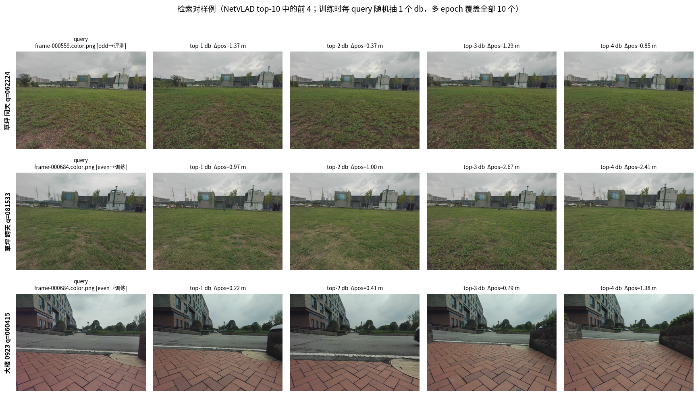

# ZC 数据微调 Reloc3r / XFeat 并回测精度 — 实施方案（待评审）

（2026-10-09。**本文档只是方案，未实现**——所有命令标「未来命令」，评审通过后再执行。
目标 = 在已采集的 ZC 三场景数据上微调 Reloc3r（sim5+bm3 行的 relpose 模型）与 XFeat，
然后回测微调后模型在**同样这三场景**上的精度，与官方权重基线逐项对比。
上游依据 = `reloc3r和xfeat模型训练与数据方案.md`（数据/许可/标签口径）、
`docs/汇总/优化实施记录_202610081555.md` §5（基线数字）。
本方案的耗时数字含**本机 RTX 5090 Laptop 24G 实测吞吐**（见 §6，非估算）。）

## 0. 结论先行

| 项                     | 判定                                                                                                                                                                                       |
| ---------------------- | ------------------------------------------------------------------------------------------------------------------------------------------------------------------------------------------ |
| 现在能否开训           | **基本能**——陷阱 A（旧位姿链）已于 2026-10-10 删除消除（见 §1），剩陷阱 C 一个钩子待补即可训                                                                                      |
| Reloc3r 可训性         | ✅ 就绪度高：`ZcRelpose` 数据类已实现、reloc3r-512 权重本机已缓存、训练吞吐已实测（17.8 对/s）                                                                                           |
| XFeat 可训性           | ⚠️ 路径 A（合成 warp）就绪；路径 B（几何对应点）需先补深度 + 写 npz 生成器（~150 行，本方案不含实现）                                                                                    |
| 数据是否够             | ✅ 三场景检索对**全部已生成**（实测 §2）：同天 6 760 + 跨天 8 230 + 0923 8 150 = **2.31 万对**，超域微调 2–5 万下沿                                                          |
| 防泄漏                 | 核心协议 =**query 帧奇偶切分**（train/eval 查询帧不相交），得到"域适配"可信数字；另附"全训全测"上限行（用户字面要求，标注为记忆上限，不可当泛化）                                    |
| 单卡总耗时（实测推算） | Reloc3r 30 epoch 混训 ≈**6–8 h**；XFeat 路径 A 40k step ≈ **6–7 h（估算，未实测）**；三场景回测 ≈ 20 min                                                                  |
| 主要风险               | ① 灾难性遗忘（ZC 仅 3 场景，纯 ZC 微调会伤公开域）→ 必混公开数据 + 遗忘检查；② A2 along-track 是架构性的，微调只能缓解不能根治；③ Reloc3r CC BY-NC-SA 非商用（研究回测无碍，量产另议） |

---

## 1. 三个前置陷阱（评审重点：这三条不修，后面全白做）

### 陷阱 A：旧位姿链 `data/zc` —— **已消除（2026-10-10 执行）**

原问题（实测 50 帧对比，旧链 vs 定稿链位置差 ~2 m、旋转矩阵元素差 ~1.97）：
`reloc3r/datasets/zc_retrieval.py` 默认 `DATA_ROOT='./data/zc'`（旧 glm 链产物，缺 R_BL），
且草坪检索对 npy 的 `query_path/db_path` 写死 `./data/zc/...` → 直接训练会喂错 2 m 级的位姿标签。

**处置（已完成，`data/zc` 从此不存在，只保留定稿链）**：

1. `data/zc_fix/` 草坪三包 png（原为指向旧链的软链）物理化（图片内容与位姿链无关，cp 落盘）；
   pose.txt 逐一 md5 校验**未改动**。
2. 删除 `reloc3r/data/zc/`（旧链目录）。
3. `zc_retrieval.py::DATA_ROOT` → `'./data/zc_fix'`（docstring 同步）。
4. 草坪两个 pair npy 的 `./data/zc/` → `./data/zc_fix/`（16 460 + 13 520 条路径改写，
   原文件备份 `/tmp/zc_pair_backup/`；0923 对文件本无旧链引用，0 改动）。
5. `eval_zc.py`：`DATA_ROOT` → `./data/zc_fix`，且 **extract 内嵌定稿链 `@ R_BL @`**——
   以后重抽 bag 直接产正确位姿，不再产生旧链。
6. `eval_zc_qwen.py`：`fixpos` 子命令删除（旧链源已不存在，反解函数失效属预期）；
   sanity 的 T_mb 反解改为从定稿链 pose 正解（`pose_fix @ T_lc @ R_BL^T`，代数自检逐位复原 2.2e-16）。

回归验证（全部通过）：ZcRelpose 冒烟 823 对、20 对随机 GT 相对平移 median 0.83 m（∈[0.3,3] 域）；
`eval_zc.py sanity` PASSED（相邻帧 rot 0.14°/trans 1.3 cm）；XFeat snap 40 帧 100% 可解 ep med 0.138 m；
`eval_zc_sim3.py 081533` 全量重跑 terr 0.61/0.23/1.24 = 归档数字（改写路径无损）。

→ 训练启动前的 GT 平移量级断言**仍保留为习惯**（防新 bag 抽取时再引入错链），但不再需要 ROOT=/路径改写。

### 陷阱 B：0923 检索对**已存在**（上游文档 §1.2 的"缺口"判断是错的）

实测 `_db-q_pair_info/`：`zc9_20260923_060415_..._q-retrieval_db-step=1_topk=10.npy` 在，
**815 query × 10 = 8 150 对**。故三场景对**无需重新生成**，上游文档"0923 对文件还没生成"应作废。
（生成工具 `eval_zc.py` 的 TopkRetrieval 段仍在，仅当要换 topk/step 时才用。）

### 陷阱 C：缓存评测脚本绑死官方权重，微调后缓存失效

`relopt/scripts/eval_zc_sim3_cache.py` 与 `reloc3r/eval_zc_sim3.py` 均调
`setup_reloc3r_relpose_model("Reloc3rRelpose(img_size=512)")` → 内部 `from_pretrained('siyan824/reloc3r-512')`
**写死官方权重，无 `--weights` 钩子**；且 `cache/enc_<db>.npz`（db 侧 encoder 特征）是用**官方权重**预计算的。

→ **后果**：微调权重无法喂进现有评测链；即便改了模型加载，旧 enc 缓存仍是官方特征，
缓存路径的"数学恒等"前提（P0-2）被破坏，结果错。
→ **修法（评审后）**：给评测脚本加 `--weights <ckpt>`（`load_state_dict`）+ **用微调权重重跑
`export_reloc3r_enc.py` 重建 enc 缓存**；或回测阶段直接用**非缓存**的 `eval_zc_sim3.py`（慢一倍但无缓存一致性问题，
回测只跑一次、20 min 量级，**推荐非缓存路径，省事且不会踩缓存陈旧**）。
XFeat 侧无此问题：`modules/xfeat.py::XFeat(weights=...)` 本就接受权重路径，评测脚本 `eval_zc_xfeat.py`
把 `XFeat(top_k=...)` 改成 `XFeat(weights=<ckpt>, top_k=...)` 即可（~1 行）。

---

## 2. 数据现状（实测，决定"数据够不够"）

| 场景      | query bag           | db bag              | 检索对 npy                             | 对数（实测）             |
| --------- | ------------------- | ------------------- | -------------------------------------- | ------------------------ |
| 草坪 同天 | 20260921_062224     | 20260921_064638     | `zc_20260921_062224_...topk=10.npy`  | 676×10 =**6 760** |
| 草坪 跨天 | 20260920_081533     | 20260921_064638     | `zc_20260920_081533_...topk=10.npy`  | 823×10 =**8 230** |
| 大楼 0923 | 20260923_060415_... | 20260923_055425_... | `zc9_20260923_060415_...topk=10.npy` | 815×10 =**8 150** |
|           |                     |                     | **合计**                         | **23 140 对**      |

- 帧文件：`data/zc_fix/<bag>/seq-01/frame-XXXXXX.{color.png,pose.txt}`，三场景共 3 898 帧（zc_fix 2 189 + zc_0923 1 709）。
- 内参：ZC 前视针孔 K 全包恒定，`zc_retrieval.py` 已内置 INTRINSICS（bag 内 camera_info 实测核对）。
- 检索对是 **NetVLAD 命中的 db-query 对**（有共视、贴部署分布），质量优于随机对；**评测**候选序另取
  **MegaLoc** 的 order 矩阵（见 §2.1 步 3 与下方答疑）——两者分属训练制对与部署检索两个环节。

 疑问：如果以后更换了检索模型，检索对数据是不是需要重新生成？另外，这里MegaLoc/NetVLAD到底使用的哪个模型？

> **答**：这里其实是**两个模型、各管一个环节**：①**训练制对 = NetVLAD**（`reloc3r/image_retrieval/topk_retrieval.py`，
> VGG16-NetVLAD-Pitts30K，hloc 官方 `.mat` 权重，全局描述子余弦相似度取 top-10 → `_db-q_pair_info/*.npy`）；
> ②**评测候选序 = MegaLoc**（gberton 本地权重，`MegaLoc/scripts/eval_zc_megaloc.py`，见步 3 答疑）。
> 换模型的影响也分两半：换**制对**模型 → 重跑步 2 `retrieve` 重新生成 npy（帧与位姿链不受影响，分钟级）；
> 换**部署检索**（MegaLoc）→ 用新模型重跑评测 order 存档，训练 npy 可不换（但建议同步重生成，保持
> 训练/评测的对分布一致）。

疑问：这里的检索，是用MegaLoc/NetVLAD检索出模型认为和当前帧最相似的10帧，后面会计算当前帧与这10帧之间的相对位姿作为真值，是这样吗？

> **答**：前半对、后半要修正：检索（NetVLAD）只决定"**和哪些 db 帧配对**"（top-10 候选），**不提供任何位姿标签**。
> GT 相对位姿与检索模型无关——由两帧各自的 `pose.txt`（/map 定稿链、米制 c2w）在 loss 内现算
> `inv(P_db) @ P_q`（`loss.py:129`，双向 L21）。检索输出的相似度只用于排序选候选，不换算成位姿；
> 它的作用是保证配对有共视、贴部署分布（优于随机对）。

- `ZcRelpose.__len__ = query 数`（每个 `__getitem__` 从该 query 的 top-10 里**随机取 1 个 db**），
  故一个 epoch = query 数，10 个候选靠多 epoch 随机覆盖；训练串用 `"N @ ZcRelpose(...)"` 过采样控制每 epoch 采样量。

**结论**：数据量够一轮认真的域微调（下沿 2 万已达）。稀缺的仍是**场景数（仅 3）与条件覆盖**，
这决定"必须混公开数据防遗忘"（§4），不是数据不够。

### 2.1 数据准备全流程（mcap → 可训练对，逐步）

全部产物**已在机**（下表「状态」列）；只有新增 bag / 换抽帧参数时才需要重跑前两步。
执行环境 = `conda activate mv2d`，工作目录 = `/data/code/reLocation-all/reloc3r`。

| 步 | 做什么                                                                                                                                                                                                                                                                                                                                                                                                                                                                                                           | 命令（已执行过；重跑会覆盖同名产物）                                                                                                                                                                                                                              | 产物 / 状态                                                                                                                                                                                                                                                                                                                                                                                                                                                                             |
| -- | ---------------------------------------------------------------------------------------------------------------------------------------------------------------------------------------------------------------------------------------------------------------------------------------------------------------------------------------------------------------------------------------------------------------------------------------------------------------------------------------------------------------- | ----------------------------------------------------------------------------------------------------------------------------------------------------------------------------------------------------------------------------------------------------------------- | --------------------------------------------------------------------------------------------------------------------------------------------------------------------------------------------------------------------------------------------------------------------------------------------------------------------------------------------------------------------------------------------------------------------------------------------------------------------------------------- |
| 0  | 原始数据与标定                                                                                                                                                                                                                                                                                                                                                                                                                                                                                                   | 无需命令。mcap 在`/data/data/reLocationData/zc_data`（草坪 3 包）与 `.../研发大楼数据`（0923 2 包）；相机内参 K/D 直接读 bag 内 `/camera_01/color/camera_info`（全包恒定）；lidar→cam 外参读 `CALIB_DIR=.../hesai_022419/image_02/lidar_to_image_02.txt` | 在机                                                                                                                                                                                                                                                                                                                                                                                                                                                                                    |
| 1  | **抽帧 + 位姿链**（extract）                                                                                                                                                                                                                                                                                                                                                                                                                                                                               | 草坪：`python eval_zc.py extract`；大楼：`python eval_zc_0923.py extract`                                                                                                                                                                                     | `data/zc_fix/<bag>/seq-01/frame-XXXXXX.{color.png,pose.txt}`（草坪 2 189 帧）+ `data/zc_0923/<bag>/seq-01/...`（1 709 帧），共 3 898 帧。在机<br />疑问：这里的pose.txt的位姿，是谁相对谁的位姿？是相机在map坐标系的位姿吗？<br />**答**：是。4×4 c2w = T_map_cam（相机系→map 系，米制），来源 = /map 定位链 `T_map_lidar @ R_BL @ T_cam_lidar`（`eval_zc.py:119`）。用的时候再现转相对位姿：训练 loss `inv(P_db)@P_q`；评测把聚合结果与 query 的 P 直接比平移/旋转。 |
| 2  | **检索对**（retrieve）                                                                                                                                                                                                                                                                                                                                                                                                                                                                                     | 草坪：`python eval_zc.py retrieve`；大楼：`python eval_zc_0923.py retrieve`                                                                                                                                                                                   | `_db-q_pair_info/{zc_,zc9_}<qbag>_q-retrieval_db-step=1_topk=10.npy`，共 23 140 对。在机                                                                                                                                                                                                                                                                                                                                                                                              |
| 3  | 评测候选序（仅回测用）<br />疑问：评测候选序是什么，怎么得到，如何使用？<br />**答**：order = MegaLoc 对每个 query 帧的**全库相似度降序 argsort 矩阵**（shape n_q×n_db，如同天 676×690），由 `MegaLoc/scripts/eval_zc_megaloc.py:88`（`order=argsort(-sim)`）产出并存档于 `res__*.npz`。使用 = `eval_zc_sim3.py` 取 `order[:, :SIM3_K]` 作为该 query 的候选 db 帧（GT-free，复现线上部署的检索环节），再 relpose + motion averaging。**训练不用它**（训练用 NetVLAD top-10 npy）。 | 无需重跑：MegaLoc 存档`MegaLoc/outputs/eval_zc_megaloc/res__*.npz` 的 `order` 矩阵                                                                                                                                                                            | `eval_zc_sim3.py` 取 `order[:, :SIM3_K]` 作候选。在机                                                                                                                                                                                                                                                                                                                                                                                                                               |
| 4  | **奇偶切分**（防泄漏）                                                                                                                                                                                                                                                                                                                                                                                                                                                                                     | 无需命令：代码内过滤（训练`ZcRelpose(query_parity=...)`；回测 `EVAL_PARITY=...`）                                                                                                                                                                             | train=even 1 158 query / eval=odd 1 156 query（×10 即对数）。零新数据                                                                                                                                                                                                                                                                                                                                                                                                                  |
| 5  | 防遗忘锚                                                                                                                                                                                                                                                                                                                                                                                                                                                                                                         | 无需下载：`data/megadepth1500`（6.2 G）在机                                                                                                                                                                                                                     | 训练`MegaDepth_valid(pair_subset=750)`；遗忘检查 `pair_subset=0`（后 750 对，与训练不相交）                                                                                                                                                                                                                                                                                                                                                                                         |
| 6  | XFeat 路径 A 底图                                                                                                                                                                                                                                                                                                                                                                                                                                                                                                | `mkdir -p data/zc_frames && ln -sf .../zc_fix/*/seq-01/*.color.png data/zc_frames/`（在 accelerated_features 仓，§5.1）                                                                                                                                        | 软链即可；标签=在线合成 warp，无额外准备                                                                                                                                                                                                                                                                                                                                                                                                                                                |

**步 1 细节（决定标签对不对，最重要）**：

- 抽帧：10 Hz 图像每 5 帧取 1（`IMG_STEP=5` → 2 Hz）；与 `/map` 话题时间同步，残差 >100 ms 的帧丢弃（`SYNC_MAX_MS`）。
- 去畸变：`cv2.initUndistortRectifyMap(K, D, None, K, (640,480))` 重映射，输出 640×480 无畸变 png。
- 位姿：`pose.txt = T_map_lidar @ R_BL @ T_cam_lidar`（4×4 c2w，米制）。`R_BL` 是雷达系(x右/y后/z下)→/map 系(x前/y左/z上)的固定旋转，**缺它即旧链、位姿错 ~2 m**（陷阱 A）。重抽 bag 时该链已内嵌在 extract 里，不会再产旧链。
- 自检守卫：`ZcRelpose` 构造时采样 20 帧断言 `median(pose[2,2]) ∈ (-0.5, 0)`（相机光轴俯角 ~10°），旧链 +0.2 直接 fail-fast（`zc_retrieval.py::_pose_chain_guard`）。新 bag 抽完先跑一次 `ZcRelpose` 冒烟即可验证链正确。

**步 2 细节（检索对 npy 的格式）**：object ndarray，shape `(n_query, 10)`；元素为 dict
`{query_path, db_path, query_idx, db_idx}`，路径形如 `./data/zc_fix/<bag>/seq-01/frame-XXXXXX.color.png`
（相对 reloc3r 仓根；0923 在 `./data/zc_0923/...`）。db = 部署地图包全帧建 NetVLAD 库，
每个 query 帧取相似度 top-10 → 天然有共视、贴部署分布。

### 2.2 训练数据如何喂给模型（ZcRelpose 语义）

- `__len__` = query 帧数；每次 `__getitem__` 从该 query 的 top-10 里**随机抽 1 个 db** 组成 (db, query) 视图对
  （view 顺序固定 `[db, query]`）→ 一个 epoch = query 数，10 个候选靠多 epoch 随机覆盖。
- 训练串 `"N @ ZcRelpose(...)"` 的 N = 每 epoch 采样对数（过采样系数），四路相加 = 一个 epoch 总量
  （`scripts/finetune_zc.sh`：N=4000×3 场景 + ND=4000 MegaDepth）。
- 图像：`_crop_resize_if_necessary` 到 512×384（与评测 `load_images(size=512)` 同宽高比），内参同步缩放；
  `transform=ColorJitter` = `ColorJitter(0.5,0.5,0.5,0.1)+ImgNorm`（跨光照）。
- 标签：不另存标签文件——GT 相对位姿在 loss 里现算 `inv(P_db) @ P_q`（`loss.py:129`，双向 L21），
  P 即两帧 `pose.txt`。故**位姿链错 = 标签错**，这就是步 1 守卫存在的原因。
- 评测子集与训练子集只靠 `query_parity` 一个参数区分，同一份 npy、同一份帧，无第二份数据副本。

### 2.3 测试数据如何处理（回测口径）

- eval 帧集 = 奇数 query 帧（`EVAL_PARITY=odd`，`eval_zc_sim3.py::_parity` 按 `frame-XXXXXX` 号过滤）。

疑问：这里训练用的偶数帧，测试用的奇数帧，是这样吗？

> **答**：是。query 帧号 %2==0 → 训练（`ZcRelpose(query_parity='even')`），%2==1 → 评测（`EVAL_PARITY=odd`），
> 两侧 query 帧不相交（实测 even 1 158 / odd 1 156）；**db 帧不切分**（db = 部署地图，两侧共享合法，泄漏只发生在 query 侧）。
> 另有一档 all→all 上限行（§3.2，含 pair 级泄漏，只作记忆上界）。

- 每 query 的候选 = MegaLoc `order` 矩阵前 `SIM3_K=5` 个 db 帧（GT-free）；`SIM3_BM3=1` 时再按
  候选位置中位数 3 m 半径筛离群；K 对 relpose 批量推理 → motion averaging → 与 query 的 `pose.txt`
  比出 ep/eθ（并存 dvec 供 A2 沿/跨轨分解）。
- 基线与微调**同 eval 帧、同 order、同聚合**，唯一变量 = `WEIGHTS` 环境变量（空=官方权重）。
- XFeat 回测走 `accelerated_features/scripts/eval_zc_xfeat.py`（snap 协议），帧集同奇偶过滤。
- 遗忘检查不吃 ZC：`MegaDepth_valid(pair_subset=0)` 后 750 对，与训练前 750 对不相交（种子 777 置换）。

### 2.4 可视化（实测生成）

图在 `relopt/docs/算法优化/figs_zc_data/`（生成脚本 `/home/yr/.hermes/cache/scratch/make_zc_data_figs.py`，可重跑）：

- `fig1_pipeline.png` — 数据处理流水线：mcap → extract → 检索对 npy → 奇偶切分 → 训练/回测两路 + 防遗忘锚。
- `fig2_traj_parity.png` — 三场景相机轨迹（map 系 x-y）：db 绿线不切分，query even(训练)蓝点 / odd(评测)红叉，
  可见两半沿轨迹交错、空间上重叠（切的是帧号不是区域，保证 train/eval 同分布）。

疑问：对于每个包，我看这里训练和测试数据都是从同一个包中切分奇偶得到的，怎么会出现跨天和同天的概念？

> **答**：同天/跨天是**场景**的属性（query 包 vs db 包的关系），不是切分的属性。一个场景 = 1 个 query 包 + 1 个 db 包：
> 同天 = q062224 vs db064638（同一天录），跨天 = q081533 vs db064638（query 与地图隔一天），0923 = 大楼两包。
> 奇偶切分是在**每个场景内部**把 query 帧劈两半；三场景各自贡献 even/odd。所以训练集 = 三场景 even 半的并
> （天然含同天、跨天、大楼三种条件），评测集 = 三场景 odd 半的并，报告按场景分行聚合。

- `fig3_pair_examples.png` — 每场景随机 1 个 query + 其 top-4 db 检索对实拍图，标题带 GT 基线距离
  （0.2–2.7 m，落在 relpose 有效域内）。

疑问：` relpose 有效域内` 是多大的距离？为什么有些top 1的距离比其它相似的图片还大？

> **答**：
>
> - **有效域**：代码/论文无硬阈值，是本仓经验口径——陷阱 A 回归验证"20 对随机 GT 相对平移 median 0.83 m ∈ [0.3, 3] m"；
>   实测三场景 top-10 对 GT 基线 med 1.14/1.42/1.34 m、p95 8.0/10.2/5.6 m、p5 0.07/0.19/0.06 m。
>   即可靠回归区间在**分米到数米**；<0.1 m 的小基线是病态退化区（平移方向不可观，详见下方追问答），
>   > 10 m 共视变弱属尾部——评测侧 bm3 的 3 m 投票筛就是切大基线尾部的。
>   >
> - **top-1 不是最近帧是常态**：检索按**外观相似度**排序，不按空间距离。实测 top-1 并非 top-10 中最近 db 的
>   query 占比：同天 59%、跨天 71%、0923 29%（草坪重复纹理、环线重访使"像但远"普遍存在；反之近帧可能视角差大）。
>   所以 top-1 的 GT 距离大于 top-2..4 不奇怪。这正是训练从 top-10 **随机抽 1**（不固定 top-1）、
>   评测用 bm3 投票 + motion averaging（不信单对）的原因。

疑问：这里的MegaLoc的作为是什么，既然数据是用的NetVLAD来检索的，为什么还要用MegaLoc？

> **答**：两者各占一个环节、互不替代。**NetVLAD 只是训练制对工具**（reloc3r 官方训练管线自带，产物=已归档 npy）；
> **MegaLoc 是部署链的检索段**——量产方案 A = Reloc3r + MegaLoc + sim3（MegaLoc 描述子 37 ms/帧，见优化路线 §方案 A），
> 回测要评的是"部署时真实跑的整条链"，故评测候选取 MegaLoc 的 order；MegaLoc 单帧 top-1 位姿重定位还是对照基线。
> 若评测改用 NetVLAD 的序，评的就是一条部署中不存在的链，数字对不上量产口径。

**追问（2026-10-13）：为什么制对用 NetVLAD、评测用 MegaLoc？用同一个模型不是更合理吗，不然检索分布不一致？**

> **答**：你的担心成立，但两边"不一致"的代价不对称，现状是代价最小的组合：
>
> 1. **两个环节的目标不同**。制对只要求"候选有共视、基线落在可回归区间"——任何 decent 的全局描述子都够，
>    且 GT 标签来自 pose.txt 与检索模型无关，检索模型不贡献标签、只贡献候选集；评测的检索段则是**被评对象的一部分**
>    （部署链 = MegaLoc 检索 + Reloc3r relpose + 聚合），必须用部署模型，否则回测数字对量产无意义。
> 2. **NetVLAD 制对是上游继承，不是新决策**：`_db-q_pair_info/*.npy` 由 reloc3r 官方管线（TopkRetrieval=NetVLAD）
>    在 2026-09 生成并归档，基线/回测/报告全部数字建立在它之上；MegaLoc 的 order 存档当时还不存在。
> 3. **分布不一致的实测大小**：同天场景 NetVLAD top-10 集合 vs MegaLoc top-5 集合，逐 query 交集
>    mean 2.69 / med 3 / 5（n=676，即 MegaLoc 前 5 里约一半也在 NetVLAD 前 10 内）——有偏但不互斥。
>    且训练每 query 从 top-10 **随机抽 1**、30 epoch 过采样，候选集差异被进一步摊薄；评测侧 bm3 投票 +
>    motion averaging 也不信单个候选。
> 4. **统一的代价**：把制对换成 MegaLoc = 重跑 retrieve（分钟级）+ **全部基线/回测/报告数字作废重跑**（GPU 小时级），
>    而收益只是"候选分布更贴评测"——对域适配结论方向无影响（标签不变、query 帧集不变）。
>    **决策**：维持现状；若后续要做"检索-回归联合优化"或追加新场景数据（反正要重生成 npy），届时制对统一换 MegaLoc，
>    一次切换、全链重跑。单为口径洁癖现在切换 = 负收益。

**追问（2026-10-13）："<0.1 m 病态"是什么意思？**

> **答**：指 (db, query) 两相机中心距离过小（<~0.1 m，即 2 Hz 下约 0.2 s 内的位移）时，相对位姿回归问题**病态（ill-posed）**：
>
> - **平移方向不可观**：相对平移 t 只能靠视差方向估计；基线→0 时视差→0，t 的方向任意小噪声都被放大（方向误差 ∝ 噪声/基线），
>   回归目标本身退化成一个点，学不到有效梯度信号。
> - **旋转与平移耦合/尺度歧义**：小基线下图像变化几乎纯由旋转贡献，网络难以把"平移分量"从旋转里分离（纯旋转对任何平移都自洽）。
> - 后果 = 这类对进训练是噪声标签（GT 相对平移本身也在 /map 噪声底内：优化路线实测 /map p50 0.39 m，0.1 m 级 GT 已低于 GT 噪声），
>   进评测则误差指标无判读意义。
>   参照（类比，非同一模型）：DA3 在 ZC db 帧距 0.57 m 已实测失效（上游文档 §4.2），说明小基线退化在 ZC 这种慢速平台上是真实威胁；
>   Reloc3r 无硬阈值，故本方案用经验域（分米~数米）+ 检索 top-k 天然避开近邻帧（top-1 med 0.2–0.6 m，p5 才到 0.06–0.19 m 尾部）。




---

## 3. 防泄漏评测协议（本方案的核心设计）

用户要"在这些数据集上训练、在这些场景上测"——这天然是域适配场景，**关键在避免 pair 级泄漏**
（同一 (query,db) 对既进训练又进评测 = 记忆，数字无意义）。设计如下：

### 3.1 主协议：query 帧奇偶切分（零新数据生成）

对每个场景，按 **query 帧索引奇偶**切成不相交两半：

- **训练集** = 偶数 query 帧的全部 top-10 对（三场景合计 ≈ 1.16 万对）
- **评测集** = 奇数 query 帧（三场景合计 ≈ 1.16 万帧，逐帧评六列）
- **db 帧不切分**（db = 部署时给定的地图，训练见 db 不构成泄漏；泄漏只发生在 query 侧）

这样 train/eval 的 **query 帧完全不相交**，评测衡量的是"同场景、没见过的查询帧"上的域适配精度——
可信、可写进报告。实现上 = 在 `ZcRelpose` 加一个 `query_parity∈{even,odd,all}` 过滤参数（~5 行），
train 用 even、eval 用 odd。

### 3.2 附：全训全测上限行（用户字面要求，标注为记忆上限）

额外跑一档 **train=all（全部 query 帧）、eval=all**——这是"模型在这些场景上能拟合到的上限"，
**含 pair 级泄漏，只作上界参考，不得当作泛化精度**。报告里两行并列，明确标注区别。

### 3.3 基线对齐（apples-to-apples）

每个场景的**官方权重基线必须在与微调评测完全相同的 eval 子集（奇数帧）上重算**，
不能直接引用归档 `res_*_sim5bm3.npz`（那是全帧口径）。即：基线与微调**同 eval 帧、同检索 order、同聚合**，
唯一变量 = relpose/特征权重。归档全帧数字（§5 表）仅作历史参照。

---

## 4. Reloc3r 微调方案

### 4.1 起点权重

用本机已缓存的 **`siyan824/reloc3r-512`**（HF cache 有 `model.safetensors`，实测
`Reloc3rRelpose.from_pretrained('siyan824/reloc3r-512')` 5.2 s 加载成功）作 `--pretrained`，
**不下载 DUSt3R**（reloc3r-512 已是 DUSt3R 之上的成品 relpose 权重，起点更高）。
若 `train.py --pretrained` 只吃 `.pth`，需一次性把 safetensors 转 pth（`from_pretrained` 可读，转换 ~5 行，评审后做）。

### 4.2 训练配置（混公开数据防遗忘）

| 参数                | 值                                                                                                | 依据                                                                        |
| ------------------- | ------------------------------------------------------------------------------------------------- | --------------------------------------------------------------------------- |
| 训练数据            | ZC even 对（三场景，`"20_000 @ ZcRelpose(...)"` 过采样）**70%** + ScanNetpp **30%** | §2 数据够；混公开域防灾难性遗忘（上游文档 §2.2 硬要求）                   |
| freeze_encoder      | ✅ 开                                                                                             | 官方`train_small.sh` 口径；实测冻结后可训参数 123.4M/426.5M，24G 卡放得下 |
| resolution          | 512×384（ZC 640×480 同宽高比）                                                                  | 与评测`load_images(size=512)` 一致                                        |
| lr / epochs / batch | 1e-5 / 30 / 8（VRAM 10.7G，可上探 16）                                                            | `train_small.sh` + 本机实测                                               |
| loss                | `RelativeCameraPoseRegression(L21)`（默认）                                                     | 平移方向角 + 旋转角，ZC 位姿标签直接喂                                      |
| transform           | `ColorJitter`                                                                                   | 跨光照鲁棒（ZC 有同天/跨天/多条件）                                         |

**ScanNetpp 前置**：需先跑 `datasets_preprocess/preprocess_scannetpp.py`（要下载 ScanNet++ 原始数据，
本机 /data 仅剩 53G，**放不下全量**）。→ 评审决策点：

- 选项 1（推荐，省磁盘）：**公开域混入改用已在机的 `data/megadepth1500`**（6.2G，reloc3r 已有
  `MegaDepth_valid` 适配）当防遗忘锚，不额外下 ScanNetpp；
- 选项 2：清 /data 腾空间下 ScanNetpp；
- 选项 3（最省，但有遗忘风险）：纯 ZC 微调，靠遗忘检查（§7）兜底，若公开域崩则回退。

### 4.3 训练命令（未来命令，未执行）

```bash
# 前置：__init__.py 注册 ZcRelpose + 实现 query_parity（陷阱A 已消除，DATA_ROOT 默认 zc_fix）+ 陷阱C评测钩子；conda activate mv2d
cd /data/code/reLocation-all/reloc3r
python train.py \
  --train_dataset "14_000 @ ZcRelpose(scene='20260921_064638', query_scene='20260920_081533', query_parity='even', resolution=[(512,384)], transform=ColorJitter) \
                 + 14_000 @ ZcRelpose(scene='20260921_064638', query_scene='20260921_062224', query_parity='even', resolution=[(512,384)], transform=ColorJitter) \
                 + 14_000 @ ZcRelpose(scene='20260923_055425_real_robot_record_external_lz4', query_scene='20260923_060415_real_robot_record_external_lz4', query_parity='even', resolution=[(512,384)], transform=ColorJitter) \
                 + 18_000 @ MegaDepth_valid(split='train', resolution=(512,384), transform=ColorJitter)" \
  --test_dataset "2_000 @ ZcRelpose(scene='20260921_064638', query_scene='20260920_081533', query_parity='odd', resolution=(512,384), seed=777)" \
  --model "Reloc3rRelpose(img_size=512)" \
  --pretrained "checkpoints/reloc3r-512.pth" \
  --lr 1e-5 --warmup_epochs 2 --epochs 30 --batch_size 8 --freeze_encoder \
  --save_freq 5 --keep_freq 10 --eval_freq 1 \
  --output_dir checkpoints/zc_finetune
# 说明：ZcRelpose(query_parity/ROOT) 与 MegaDepth_valid(split='train') 均为待实现的适配点（评审后）
```

### 4.4 产物

`checkpoints/zc_finetune/checkpoint-best.pth`（test loss 最优）+ `checkpoint-last.pth`；
tensorboard 日志（terr/rerr 曲线，遗忘检查看 MegaDepth 测试列）。

---

## 5. XFeat 微调方案

### 5.1 路径 A（先做，零标注零深度，就绪）

ZC 帧当合成 warp 底图（上游文档 §4.2 路径 A）：

```bash
# 未来命令：ZC 合成 warp 微调
cd /data/code/reLocation-all/accelerated_features
mkdir -p data/zc_frames && ln -sf /data/code/reLocation-all/reloc3r/data/zc_fix/*/seq-01/*.color.png data/zc_frames/
python3 -m modules.training.train --training_type xfeat_synthetic \
  --synthetic_root_path data/zc_frames --ckpt_save_path ckpts/zc_synth \
  --n_steps 40000 --batch_size 10 --lr 3e-4
```

- 标签 = 合成 homography/TPS 变换在线生成的对应点（`augmentation.py::get_correspondences`），**零标注**（上游文档 §4.1 已详述）。
- 局限（如实预期）：单应/TPS ≠ 真实 3D 视差，学的是光照/纹理鲁棒性，**不改善大视差匹配**；
  XFeat 已知短板 B1 旋转尾部已被 rc 修复 + EKF 消化，路径 A 收益有限，属低成本试错。
- 防泄漏：合成 warp 是在线随机变换，天然无 pair 泄漏；评测仍走 §3 奇偶帧子集。

### 5.2 路径 B（认真做，需深度，本方案不含实现）

ZC 版 MegaDepth-format npz（上游文档 §4.2 路径 B + 疑问②答复）：
每帧补深度 → 写 ~150 行 npz 生成器 → `MegaDepthDataset` 直读 → 与官方 xfeat.pt 混训。
**深度来源优先级**（无 LiDAR 时，见上游文档疑问②）：深度相机 `/camera_01/depth` > SfM/COLMAP >
度量深度模型（**不用 DA3**——本仓已实测 DA3 小基线失效，ZC db 帧距 0.57 m 正落失效区）。
路径 B 是否做 = 评审决策点；建议**先只做路径 A**，若 A 的 ep med 不动再评估 B。

### 5.3 XFeat 评测钩子

`eval_zc_xfeat.py` 的 `XFeat(top_k=...)` → `XFeat(weights='ckpts/zc_synth/xfeat_synthetic_40000.pth', top_k=...)`（~1 行，陷阱C）。

---

## 6. 回测协议（微调 vs 基线，同子集）

### 6.1 实测吞吐（本机 RTX 5090 Laptop 24G，本会话探针实测，非估算）

| 项                                           | 实测值                                         |
| -------------------------------------------- | ---------------------------------------------- |
| reloc3r-512 加载                             | 5.2 s，426.5M 参数                             |
| freeze_encoder 后可训参数                    | 123.4M                                         |
| 训练 step（B=8, 512×384, AMP, fwd+bwd+opt） | **450 ms/iter = 17.8 对/s，VRAM 10.7 G** |

→ **Reloc3r 30 epoch 混训耗时推算**：训练集 ≈ 6 万采样对/epoch（§4.3 四路过采样和），
6 万 / 17.8 ≈ 56 min/epoch（数据加载有 num_workers 并行会更快，此为算力上界），
30 epoch ≈ **6–8 h 单卡**（含公开域数据加载）。VRAM 10.7G@B8 → 可上探 B16（~20G）提速近一倍。
→ XFeat 路径 A 40k step：未实测，按上游文档 160k step≈1 天线性推算 ≈ **6–7 h（估算）**。

### 6.2 回测执行（未来命令）

三场景 × {官方基线, 微调} × 奇数 eval 帧，各跑一遍，出六列（ep mean/med/p90、eθ mean/med/p90）：

```bash
# Reloc3r sim5+bm3（非缓存路径，避开陷阱C缓存陈旧；每场景 ~3-5 min）
cd /data/code/reLocation-all/reloc3r
for k in 062224 081533 0923; do
  SIM3_K=5 SIM3_BM3=1 python eval_zc_sim3.py $k --weights <ckpt> --eval-parity odd --out ...   # --weights/--eval-parity 为待加钩子
done
# 基线：--weights 省略(官方) 同 --eval-parity odd 重跑一遍

# XFeat snap（每场景 ~2 min）
cd /data/code/reLocation-all/accelerated_features
for s in lawn_sameday lawn_crossday 0923; do
  python scripts/eval_zc_xfeat.py --scene $s --weights <ckpt> --eval-parity odd --out ...
done
```

### 6.3 结果表模板（回测后填，现在留空）

**Reloc3r sim5+bm3（奇数 eval 帧，同子集对比）**

| 场景        | 权重     | ep med | ep p90 | eθ med | eθ p90 | 备注 |
| ----------- | -------- | ------ | ------ | ------- | ------- | ---- |
| 同天 062224 | 官方基线 | 待测   | 待测   | 待测    | 待测    |      |
| 同天 062224 | ZC 微调  | 待测   | 待测   | 待测    | 待测    |      |
| 跨天 081533 | 官方基线 | 待测   |        |         |         |      |
| 跨天 081533 | ZC 微调  | 待测   |        |         |         |      |
| 0923        | 官方基线 | 待测   |        |         |         |      |
| 0923        | ZC 微调  | 待测   |        |         |         |      |

**XFeat snap（奇数 eval 帧）** —— 同上结构。

**全训全测上限行（含泄漏，仅上界参考）** —— 单独一张表，明确标注。

参照：归档全帧口径基线（历史，非同子集，仅量级参照）——
Reloc3r sim5+bm3 ep med/p90 = 同天 0.204/1.68、跨天 0.207/1.10、0923 0.109/0.57；
XFeat snap ep med/p90 = 同天 0.211/0.457、跨天 0.311/0.914、0923 0.166/0.410。

---

## 7. 验收门槛与遗忘检查

| 检查                 | 门槛                                                              | 不达标动作                                                        |
| -------------------- | ----------------------------------------------------------------- | ----------------------------------------------------------------- |
| 域适配有效（主协议） | 微调后三场景 ep p90**不劣于**官方基线，至少 2 场景改善 >10% | 若普遍变差 → 学习率/epoch 过大或陷阱A未修净，回查                |
| 灾难性遗忘           | MegaDepth_valid 测试 terr/rerr**不高于**官方权重 +10%       | 超线 → 提高公开域混比（30%→50%）重训                            |
| A2 along-track       | ep 沿轨分量 p90 收窄（当前跨轨 0.47 vs 沿轨 4.4 m）               | 架构性，微调只缓解；无改善则记录为"需时序/尺度约束"（EKF 已兜底） |
| 上限行合理性         | 全训全测 ep p90 应显著低于主协议（证明记忆存在）                  | 若两者接近 → 切分可能没生效，回查陷阱A/parity                    |

---

## 8. 产物与目录规划

```
reloc3r/checkpoints/zc_finetune/          # Reloc3r 微调权重 + tb 日志
accelerated_features/ckpts/zc_synth/      # XFeat 路径A 权重
relopt/results/finetune/                  # 回测六列 json/npz（基线 vs 微调，奇偶子集）
relopt/docs/算法优化/ZC微调回测结果_<ts>.md   # 回测报告（本方案执行后产出）
```

需新增/改动的代码点（评审后实现，均为小改）：

1. `ZcRelpose`：加 `query_parity` 过滤（§3.1，~5 行；原"ROOT= 覆盖"已并入陷阱 A 处置——`DATA_ROOT` 默认即 `data/zc_fix`）。
2. `reloc3r/datasets/__init__.py`：注册 `ZcRelpose`（1 行）。
3. `MegaDepth_valid`：确认支持 `split='train'`（现仅 test；不支持则混入锚改 ScanNetpp 或纯 ZC，§4.2 决策点）。
4. 评测脚本：Reloc3r 加 `--weights` + `--eval-parity`（陷阱C）；XFeat 加 `--weights` + `--eval-parity`（~各 3 行）。
5. 权重转换：reloc3r-512 safetensors → pth（若 `--pretrained` 只吃 pth，~5 行）。
6. 训练启动自检：陷阱A 的 GT 相对平移量级断言（§1A，fail-fast）。

---

## 9. 执行顺序（评审通过后）

> **2026-10-10 进度：分支 `reloc3r-finetune` 已落地全部代码点（下表勾 ✅），
> `train_small` 冒烟 + 守卫自检 + all-parity 回归逐位一致已通过。**
> 待做 = 正式训练（GPU 数小时）→ 遗忘检查 → 三场景奇偶子集回测 → 填 §6.3 表。

| 实现项                                                                            | 状态                                                  |
| --------------------------------------------------------------------------------- | ----------------------------------------------------- |
| `__init__.py` 注册 `ZcRelpose`                                                | ✅                                                    |
| `ZcRelpose(query_parity)`（even/odd/all）                                       | ✅ even+odd=all 自检通过                              |
| 位姿链守卫（数据加载 fail-fast，判定 cam-z·map-up∈(-0.5,0)，旧链 +0.2 必拒）    | ✅ 合成旧链被拒、真链放行                             |
| `eval_zc_sim3.py` env `WEIGHTS`/`EVAL_PARITY`/`OUT_TAG` 钩子              | ✅ all-parity 与归档 0.0e+00 逐位一致；odd 基线已可跑 |
| `MegaDepth_valid(pair_subset)` 不相交 train/eval 子集（各 750、overlap 0 实测） | ✅（对微调也吃 MD1500 的场合，遗忘检查仍诚实）        |
| 权重转换`checkpoints/reloc3r-512.pth`（safetensors→pth，round-trip equal）     | ✅                                                    |
| 训练入口`scripts/finetune_zc.sh`（含 `SMOKE=1` 快速自检）                     | ✅ 冒烟通过                                           |
| 遗忘检查`scripts/eval_forgetting.py`                                            | ✅ 脚本就位，官方基线待跑                             |

1. ~~修陷阱 A~~（已消除）→ 守卫已内嵌数据类，训练/评测加载即 fail-fast。
2. 修陷阱 C ✅ → 用**官方权重**在奇数子集重跑基线（D3 选定：非缓存 `eval_zc_sim3.py`），落 §6.3 基线行。
3. `SMOKE=1 bash scripts/finetune_zc.sh` ✅ → 正式 `bash scripts/finetune_zc.sh`（30 epoch ≈ 6–8 h）→ `eval_forgetting.py` 官方/ft 对比 → 奇数子集回测 → 填表。
4. XFeat 路径 A 40k step（§5.1，本分支未含——XFeat 在 accelerated_features 仓，另行分支/直接跑）→ 奇数子集回测 → 填表。
5. 全训全测上限行（§3.2）：`EVAL_PARITY=all` 且训练侧换 `query_parity` 缺省(all) 即天然可跑。
6. 汇总报告 `ZC微调回测结果_<ts>.md`：主协议（域适配）+ 上限行（记忆）+ 遗忘检查 + A2 分量，给结论。

**评审决策点（需你拍板）**：

- (D1) 公开域防遗忘锚用哪个：megadepth1500（在机、省磁盘，推荐）/ ScanNetpp（需清盘下载）/ 纯 ZC（有遗忘风险）？
- (D2) XFeat 是否只做路径 A，路径 B（需深度）暂缓？
- (D3) 回测走非缓存 `eval_zc_sim3.py`（推荐，避陷阱C缓存陈旧）还是重建缓存走 sim3_cache？
- (D4) 是否要"全训全测上限行"（§3.2）——它含泄漏，只是回答你字面的"在这些场景上训练后在这些场景的精度"，我默认做但明确标注。

## 附：本方案事实来源

- 陷阱A（zc vs zc_fix 差 2 m）：本会话 50 帧 pose.txt 实测对比。
- 陷阱B（0923 对已存在 815×10）：`_db-q_pair_info/zc9_..._topk=10.npy` 实测。
- 陷阱C（评测绑死官方权重、无 --weights、enc 缓存官方权重）：`eval_zc_sim3_cache.py:64`、
  `reloc3r_relpose.py::setup_reloc3r_relpose_model`、`cache/enc_*.npz` 审读。
- 对数/帧数：`_db-q_pair_info/*.npy` + `data/zc_fix|zc_0923` 实测（§2 表）。
- 训练吞吐 450ms/iter、17.8对/s、VRAM10.7G、reloc3r-512 426.5M/可训123.4M：本会话 GPU 探针实测。
- 基线六列：`relopt/results/res_*_sim5bm3.npz` + `accelerated_features/outputs/zc_xfeat_*.json` 实测读取。
- 训练框架/损失/数据类：`reloc3r/{train.py,loss.py,datasets/zc_retrieval.py,scripts/train_small.sh}`、
  `accelerated_features/modules/training/train.py` 审读（口径同上游 `reloc3r和xfeat模型训练与数据方案.md`）。
